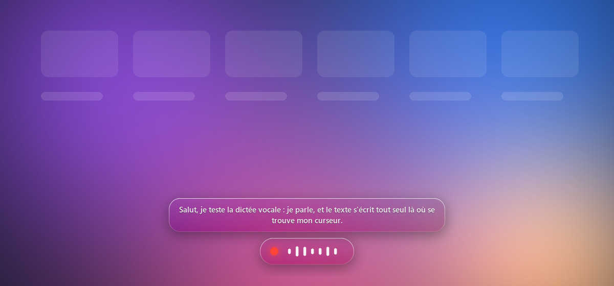

# Dictée

Dictée vocale pour Windows, qui marche dans n'importe quel logiciel.
Maintiens **Ctrl + Espace**, parle, relâche : le texte s'écrit là où se trouve ton curseur.

La reconnaissance vocale tourne **sur ton PC** grâce à [Whisper](https://github.com/openai/whisper) d'OpenAI. Rien n'est envoyé sur internet, et c'est gratuit.

**Page de présentation : https://fakerirl.github.io/dictee/**

## Ce que ça fait

- Fonctionne partout : Discord, navigateur, Word, VS Code, jeux en fenêtré…
- Le texte s'affiche **en direct** pendant que tu parles, dans une petite bulle en verre en bas de l'écran.
- Le texte est collé une à deux secondes après que tu as relâché les touches.
- Une icône près de l'horloge permet d'activer ou couper la dictée, de choisir le micro et de lancer l'appli avec Windows.
- Ponctuation et majuscules automatiques.
- Discrète : environ 80 Mo de mémoire au repos. Le modèle de reconnaissance n'est chargé que quand tu dictes.

## Installation

Il faut **Windows 10 ou 11** et **Python 3.10 ou plus récent**.

1. Si tu n'as pas Python, installe-le depuis [python.org](https://www.python.org/downloads/).
   Pendant l'installation, coche bien **« Add python.exe to PATH »**.
2. Télécharge ce projet : bouton vert **Code**, puis **Download ZIP**. Décompresse-le où tu veux.
3. Double-clique sur **`installer.bat`**. L'installation prend quelques minutes, puis l'appli se lance.

Au premier appui sur Ctrl + Espace, le modèle de reconnaissance (environ 500 Mo) est téléchargé une seule fois. Cette première dictée sera donc un peu plus longue.

Ensuite, pour relancer l'appli, double-clique sur **`lancer.bat`**, ou coche **Lancer au démarrage** dans le menu de l'icône.

## Utilisation

| Action | Comment |
|---|---|
| Dicter | Maintenir **Ctrl + Espace**, parler, relâcher |
| Activer ou couper | Clic droit sur l'icône, puis **Activée** |
| Choisir le micro | Clic droit sur l'icône, puis **Micro** |
| Lancer avec Windows | Clic droit sur l'icône, puis **Lancer au démarrage** |
| Quitter | Clic droit sur l'icône, puis **Quitter** |

Couleur de l'icône : **verte** = prête, **rouge** = écoute, **orange** = transcription, **grise** = coupée.

Astuce : Windows cache souvent les nouvelles icônes sous la petite flèche **^** à côté de l'horloge. Tu peux la glisser dans la barre des tâches pour la garder visible.

## Réglages

Les réglages sont dans le fichier `%APPDATA%\Dictee\config.json`. Pour l'ouvrir, colle ce chemin dans la barre d'adresse de l'explorateur de fichiers. Relance l'appli après une modification.

| Réglage | Par défaut | À quoi ça sert |
|---|---|---|
| `modele` | `small` | Taille du modèle. Plus il est gros, plus il est précis mais lent : `base`, `small`, `medium`, `large-v3-turbo` |
| `langue` | `fr` | Langue parlée (`en`, `es`, `de`…) |
| `vocabulaire` | vide | Mots rares à bien écrire, séparés par des virgules. Exemple : `Discord, Kubernetes, Jean-Baptiste` |
| `garder_modele_secondes` | `60` | Temps pendant lequel le modèle reste en mémoire après une dictée |

Avec `small`, une phrase de 12 secondes est transcrite en un peu moins de 2 secondes sur un processeur 8 cœurs (Ryzen 7 5700X). Si ton PC est plus ancien, essaie `base`.

## Questions fréquentes

**La bulle ne s'affiche pas dans mon jeu.**
Les jeux en plein écran exclusif passent par-dessus toutes les fenêtres. Mets le jeu en mode « fenêtré sans bordure ». La dictée fonctionne de toute façon, même sans la bulle.

**La bulle n'apparaît pas dans OBS ni sur mes captures d'écran.**
C'est normal : elle est volontairement cachée des captures, ce qui permet l'effet de verre flouté.

**Il ne se passe rien quand j'appuie sur Ctrl + Espace.**
Vérifie que l'icône est verte, et non grise. Si une erreur s'est produite, elle est notée dans `%APPDATA%\Dictee\erreurs.log`.

**Comment désinstaller ?**
Décoche **Lancer au démarrage**, quitte l'appli, puis supprime le dossier du projet et le dossier `%APPDATA%\Dictee`. Le modèle téléchargé se trouve dans `%USERPROFILE%\.cache\huggingface` : tu peux le supprimer aussi.

## Crédits

- [Whisper](https://github.com/openai/whisper) d'OpenAI, le modèle de reconnaissance vocale.
- [faster-whisper](https://github.com/SYSTRAN/faster-whisper), une version plus rapide de Whisper.

Licence MIT : tu peux utiliser, modifier et partager ce projet librement.
